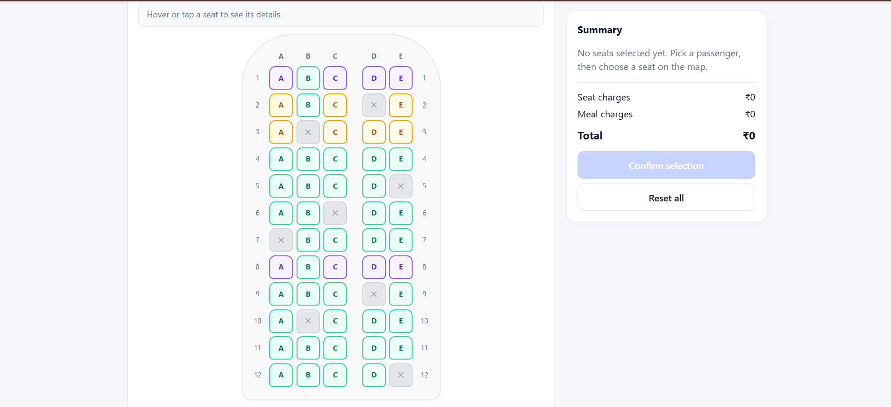
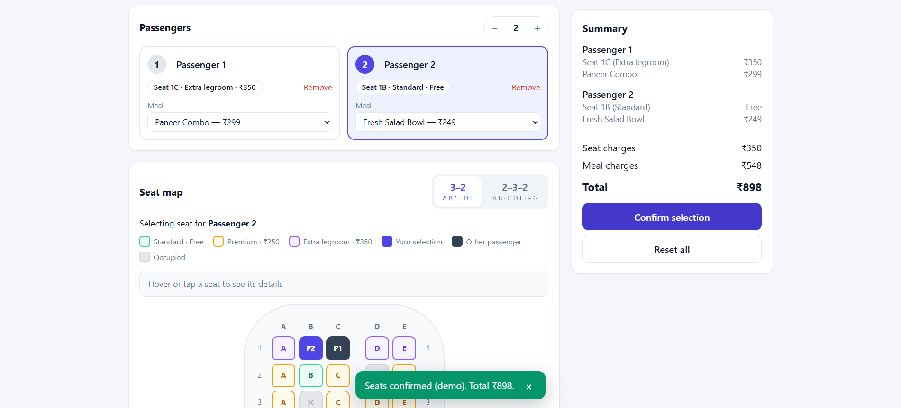
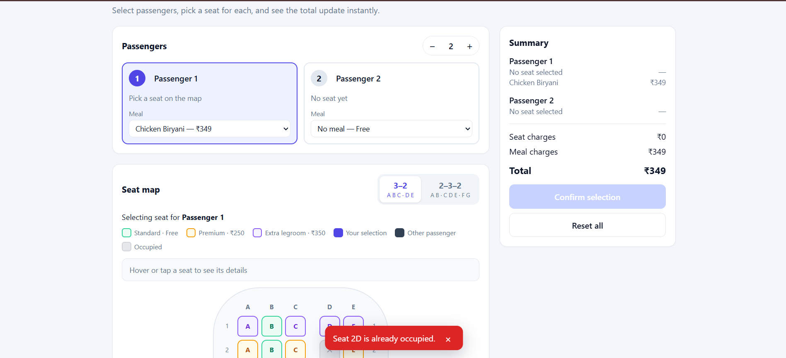
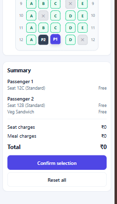
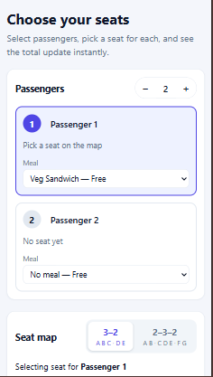

# Flight Seat Selection & Passenger Management

A React + TypeScript (Vite) app where users choose the number of passengers, pick seats on an aircraft map (two layouts), optionally choose meals, and see a live price breakdown.

**Live demo:** https://flight-seat-selection-one.vercel.app/


## Screenshots

### Seat layout (3–2)


### Assignment, meals and total


### Feedback for invalid actions


### Mobile
<p>
  
  
</p>


## Demo video
[](https://youtu.be/eVfIwipTn4g)

## Setup

```bash
npm install
npm run dev       # http://localhost:5173
npm run build     # type-check + production build into dist/
npm run preview   # serve the production build locally
```

Requires Node 18+.

Tip: open the app with `?error` (e.g. `http://localhost:5173/?error`) to see the error state of the simulated seat-map request; "Try again" then loads normally.

## Features

- 1–6 passengers, switchable at any time; names are editable.
- Two layouts: **3–2** and **2–3–2**, switchable from the UI.
- Row numbers, seat letters, aisle gaps.
- Seat states: available (coloured by price category, free seats in green), selected by the active passenger, taken by another passenger, occupied.
- Seat details bar (category, price, status) on hover, focus or tap.
- Assign, change or remove a seat; previous assignments are kept when switching passengers.
- Live total with a per-passenger breakdown (seat + meal).
- Bonus: per-passenger meal selection with free and paid options, included in the total.
- Loading skeleton, error state with retry, empty state, toast feedback for invalid actions, responsive layout.

## Project structure

```
src/
  App.tsx                 page composition, derived data
  types.ts                shared types
  data/seatMap.ts         layout configs, pricing rules, seat generator
  data/meals.ts           meal options
  hooks/useSeatMap.ts     simulated async load (loading / error / success)
  store/seatReducer.ts    all state transitions (useReducer)
  utils/pricing.ts        line items, totals, currency formatting
  components/             Seat, SeatRow, SeatMap, SeatDetails, Legend,
                          LayoutToggle, PassengerList, PassengerCountSelector,
                          Summary, Toast, SeatMapSkeleton
```

## State management

State lives in one `useReducer` in `App` (`src/store/seatReducer.ts`):

```ts
{
  passengers: { id, name }[]
  activeId: string                 // passenger currently choosing a seat
  layout: "3-2" | "2-3-2"
  seats: Record<passengerId, seatId>   // the only source of truth for assignment
  meals: Record<passengerId, mealId>
  notice: { id, type, text } | null    // toast feedback
}
```

Everything else is **derived**, never stored twice:

- `owners` (seatId -> passenger) is the inverse of `seats`, computed with `useMemo`.
- Line items and totals are computed from `passengers`, `seats`, `meals` and the loaded seat map, so the total updates instantly after any change.

## Seat assignment logic

`TOGGLE_SEAT` runs when a seat is clicked:

1. Occupied seat -> blocked, error toast.
2. Seat already held by the **active** passenger -> removes it (toggle off).
3. Seat held by **another** passenger -> blocked, error toast (no double booking).
4. Otherwise the seat is assigned to the active passenger, replacing their previous seat if they had one (one seat per passenger is guaranteed because `seats` is keyed by passenger).

After a first-time assignment the active passenger auto-advances to the next one without a seat. Changing an existing seat does not move the selection.

Other rules:

- Reducing the passenger count drops the removed passengers' seats and meals.
- Switching layout clears seat assignments (seat IDs mean different physical seats in a different aircraft) and tells the user.

## Pricing rules

Defined in `src/data/seatMap.ts` (`categoryFor`):

| Seats | Category | Price |
| --- | --- | --- |
| Rows 1 and 8 | Extra legroom | ₹350 |
| Rows 2 and 3 | Premium | ₹250 |
| All other rows | Standard | Free |
| Middle seat of a 3-seat group | Standard | Free |

Some seats are pre-occupied using a deterministic rule so the demo is identical on every load. Meals: No meal / Veg Sandwich (free), Salad Bowl ₹249, Paneer Combo ₹299, Chicken Biryani ₹349.

## Deployment

- **Vercel:** import the repo; framework preset "Vite"; no config needed.
- **GitHub Pages:** `vite.config.ts` uses `base: "./"`, so `npm run build` and publishing `dist/` works from a sub-path.